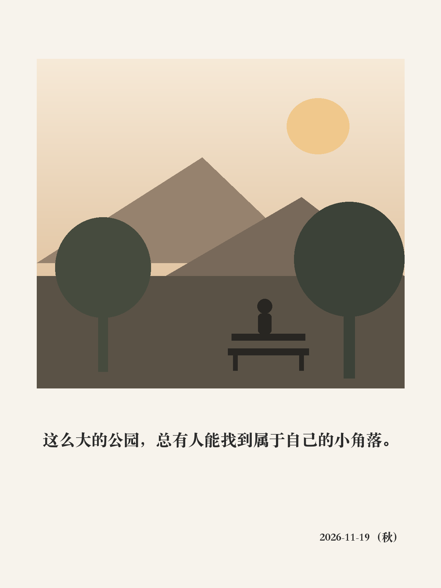

<div align="center">

# 📷 图片日记 · Photo Diary

**一张照片 · 一句话 · 一天**

纯本地运行的图片日记卡片生成器 —— 网页 / 安卓 App 双形态，零依赖、零上传、离线可用

[](#-安装到手机)
[](#-网页版--pwa)
[](#-技术实现)
[](#-字体)



*↑ 一张生成的日记卡片：照片 + 一句话 + 日期（季节自动匹配）*

</div>

---

## ✨ 功能

| 功能 | 说明 |
|---|---|
| 🖼 **照片自适应** | 横图 / 竖图 / 方图通吃，原比例等比缩放（contain），**绝不裁切、绝不变形**，窄图自动居中留白 |
| 📐 **六种画布比例** | 3:2 横 · 4:3 横 · 1:1 方 · 3:4 竖 · 2:3 竖 · 9:16 壁纸，统一 1200px 宽高清导出 |
| ↔ **版面微调** | 左右留白 / 顶部留白独立滑杆（0–30%），图片等比缩放、始终居中，极值防碰撞 |
| 💾 **留白预设** | 内置 3 套预设，可命名保存自定义组合（localStorage 持久化），自动记住上次参数 |
| 🎨 **配色自由** | 背景 / 文字颜色各带预设色板 + 自定义取色器，选深色背景自动切换浅色文字 |
| ✍️ **一句话日记** | 60 字上限，超宽自动换行，衬线排版 |
| 📅 **日期 + 季节** | 默认当天，可回填任意日期，季节（春 / 夏 / 秋 / 冬）自动匹配 |
| ⬇️ **一键导出** | 浏览器内下载 PNG · iPhone 长按保存 · **安卓 App 内直接存入系统相册** |

## 📱 安装到手机（APK）

不需要本地 Android Studio —— **GitHub Actions 云端打包**：

1. Fork / 使用本仓库 → 打开 `Actions` 标签
2. 任意 push 触发 `Build APK` 流水线（首次 3–6 分钟，之后 1–2 分钟）
3. 构建成功后在该次运行页底部 `Artifacts` 下载 **图片日记-APK**
4. 传到手机安装（首次需允许「安装未知应用」）

> 已在小米 13（澎湃 OS 3）/ 小米 15 Ultra（澎湃 OS 4）验证体验：独立图标、全屏运行、断网可用、导出直接进相册「图片日记」文件夹。

## 🌐 网页版 / PWA

仓库开启 `Settings → Pages` 后获得网址，手机浏览器打开 → 「添加到主屏幕」即可获得独立图标的全屏 App。与 APK 相互独立、可并存。

本地电脑使用：克隆仓库后直接双击 `index.html`（需保留 `fonts/` 目录），或运行 `node build-singlefile.js` 生成字体全内嵌的**单文件版**（6.6MB，发到任何设备单独使用）。

## 🔧 技术实现

```
photo-diary/
├── index.html            # 应用本体：全部 UI + Canvas 绘制 + 导出逻辑（零外部依赖）
├── manifest.json         # PWA 应用清单
├── sw.js                 # Service Worker：cache-first 离线缓存
├── icons/                # App 图标（any + maskable）
├── fonts/LXGWWenKaiScreen/   # 霞鹜文楷屏幕阅读版（unicode-range 切片 woff2 × 97）
├── android/              # 原生 WebView 壳工程（零第三方依赖）
│   └── .../MainActivity.java   # 文件选择桥 + 相册保存桥（AndroidBridge.saveImage）
├── .github/workflows/build-apk.yml   # CI：push 即云端打包 APK
└── build-singlefile.js   # 单文件版构建脚本（字体 base64 内嵌）
```

几个值得说明的设计决策：

- **Canvas 直绘而非 html2canvas**：字体渲染可控、离线可用、导出尺寸精确（1200px 宽），代价是需手动管理 webfont 加载时序（`document.fonts.load` → 绘制 → `fonts.ready` 兜底重绘）
- **选图用 label 原生触发**：iOS Safari 会拒绝「`display:none` input + JS 程序化 click」打开文件选择器，label 包裹是全平台兼容的唯一稳妥解
- **安卓导出走原生桥**：WebView 中 blob 下载不可靠，`AndroidBridge.saveImage(base64, filename)` 经 MediaStore 直写相册（API 29+ 免存储权限）
- **字体按需加载**：97 个 unicode-range 切片 woff2 共 4.9MB，浏览器只拉取实际用到的字块

## 📝 字体

[霞鹜文楷 · 屏幕阅读版（LXGW WenKai Screen）](https://github.com/lxgw/LxgwWenkaiScreen) —— 针对屏幕显示优化的楷体，遵循 SIL OFL 许可发布。

## 📄 许可

项目代码仅供个人学习与使用；字体遵循 [SIL OFL](fonts/LXGWWenKaiScreen/OFL.txt)。

---

<div align="center">
<sub>用照片记住每一天 🍂</sub>
</div>
